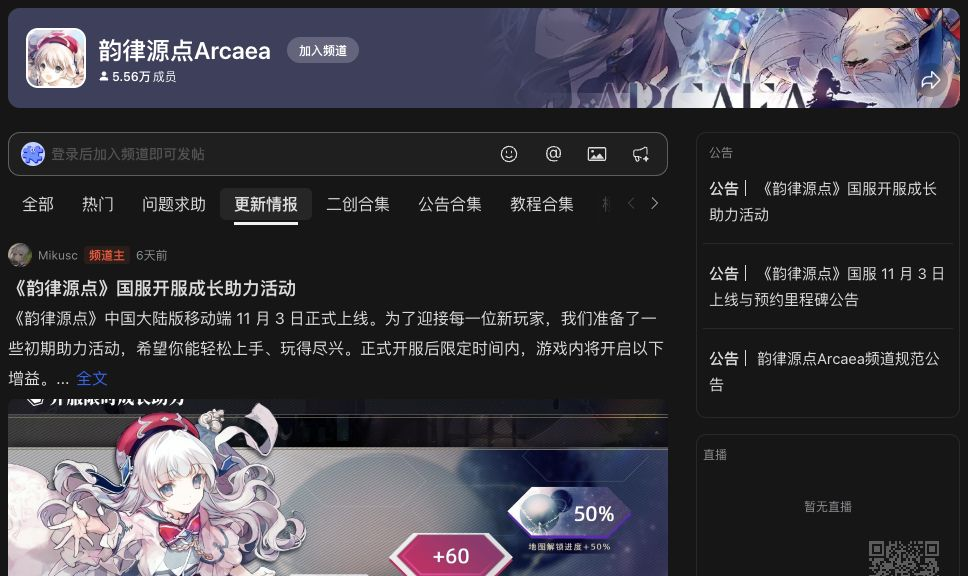

# Arcaea Skills · AI 辅助社群内容工作流

把官方动态和曲包资料整理成可核对来源、图文顺序和发布状态的腾讯频道长帖。服务于约 **5.6 万成员的 Arcaea 频道**；规模为运营背景，不代表由本工具带来的增长。

这套工作流让 AI 负责资料整理、内容分类和草稿组织，用 Python 校验图片、来源和版本关系，再由已获授权的发布流程完成写入及回读。仓库公开可复用的 Skill、脚本和测试，不包含频道登录信息或运营数据库。



*公开频道截图；游戏内容与图像权利归原权利人。成员规模由运营者于 2026 年 10 月提供。*

[个人项目主页](https://www.mikusc.top/) · [更新情报 Skill](skills/arcaea-update-publisher/SKILL.md) · [曲包介绍 Skill](skills/arcaea-pack-intro-publisher/SKILL.md)

## 解决的问题

| 场景 | 实现方式 | 可查阅的结果 |
| --- | --- | --- |
| 多条官方动态涉及同一版本 | 分类、合并主题，匹配已有版本帖子 | Markdown 草稿、来源清单、追加计划 |
| 长帖图片与文字容易错位 | 显式图片角色、顺序与连续占位符校验 | 图片映射、尺寸检查、草稿和图片 SHA-256 |
| 发帖成功与记录完成容易混淆 | 发布后核对时间线和帖子详情，再记录状态 | 独立的发布记录与推广状态 |
| 工具失败后重复发帖 | 先查实际写入结果，按当前记录重新规划 | 可回读的计划与失败边界 |

## 两个 Skill

- **`arcaea-update-publisher`**：读取 Arcaea 官方 Bilibili 动态，按版本与主题生成图文草稿；已有同版本帖子采用追加计划。支持缓存回放，旧的直接标记已处理路径会拒绝执行。
- **`arcaea-pack-intro-publisher`**：围绕曲包、歌曲、搭档与解锁信息整理有来源的介绍；校验图片角色、顺序及正文，再生成绑定内容哈希和目标频道的发布计划。

`legacy/` 保留早期工作流供查阅，当前入口为上述两个 Skill。

## 本地验证

Python 3.10+，脚本与测试使用标准库。以下命令不需要登录，也不会向腾讯频道发帖：

```bash
git clone https://github.com/Mikusc/Arcaea-skill.git
cd Arcaea-skill
python3 -m unittest discover -s skills/arcaea-update-publisher/tests -v
python3 -m unittest discover -s skills/arcaea-pack-intro-publisher/tests -v
```

测试使用临时目录和合成图片，覆盖草稿准备、同版本追加、回读后的状态记录、内容哈希变化、图片占位符错误及目标频道不一致。GitHub Actions 同样只运行这些离线检查。

## 使用与配置

将需要的 Skill 文件夹放入所用 AI 工具支持的 skills 目录，或直接打开对应 `SKILL.md`。每个文件夹内含操作说明、按需读取的参考文档和脚本。

运行示例前，从对应 Skill 目录执行命令，并配置一个独立的数据目录：

```bash
export ARCAEA_WORKSPACE="$HOME/ArcaeaChannel"
mkdir -p "$ARCAEA_WORKSPACE"
```

更新情报可先用已经取得的 Bilibili JSON 回放：

```bash
cd skills/arcaea-update-publisher
python3 scripts/prepare_arcaea_update_drafts.py \
  --workspace "$ARCAEA_WORKSPACE" \
  --raw-file /absolute/path/bili_raw_pages.json \
  --reuse-image-dir /absolute/path/prior-drafts \
  --out-dir arcaea_update_replay
```

`--reuse-image-dir` 用于已有图片；未缓存的图片仍可能触发下载。完全离线的验证使用上面的测试命令。

实际发布另需已安装并登录的 `tencent-channel-cli` 及 `tencent-channel-community` Skill；它们是外部依赖，不随本仓库分发。通过 `TENCENT_GUILD_ID`、`TENCENT_CHANNEL_ID` 指定已确认的频道与版块，再按 Skill 中的实时 schema 检查、dry-run、授权和回读步骤执行。曲包计划必须显式提供目标 ID，不再预填个人频道。

仅准备草稿和计划不会发布。`--verified` 是操作者完成回读核验后的声明，记录脚本本身不连接腾讯服务器代替核验。登录凭证、Cookie、真实草稿与发布记录应留在独立数据目录，勿提交到 GitHub。

## 实现与验证边界

AI 负责资料理解与编辑，Python 负责可重复的检查和状态更新。事实仍需对照官方来源，Wiki 攻略与主观评价须区分；图片尺寸通过也不等于来源或版权已确认。

本轮整理验证的是离线脚本与 Skill 结构，没有重新执行真实频道发布。`retrying_http_proxy.py` 是用于排查 HTTP 图片分片上传 EOF 的临时工具，不支持 HTTPS CONNECT，也不应作为通用发帖重试代理；遇到写入结果不明时必须先回读。

---

Source-backed AI-assisted editorial workflows for Arcaea community updates and pack introductions, with portable Skills, deterministic checks and verified publication records.

